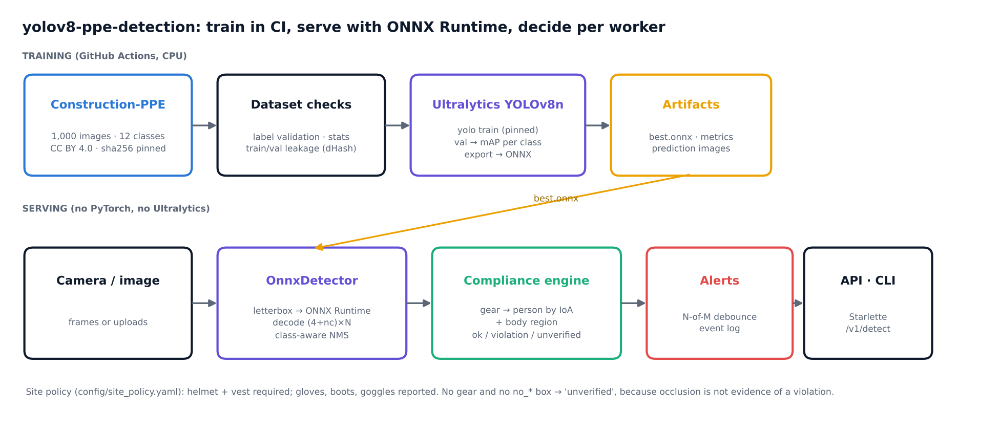
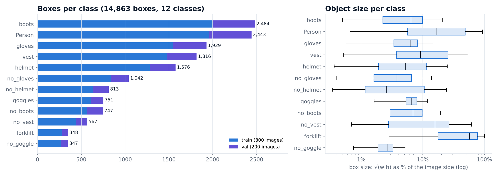
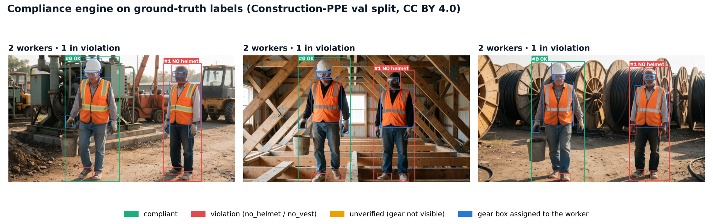
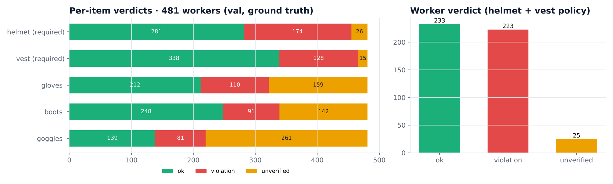
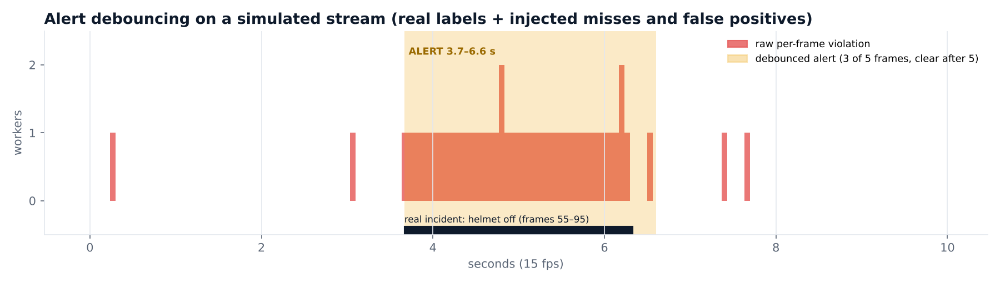

# YOLOv8 PPE Detection

[](https://github.com/vishavjit-singh/yolov8-ppe-detection/actions/workflows/ci.yml)
[](https://github.com/vishavjit-singh/yolov8-ppe-detection/actions/workflows/train.yml)


Safety-gear detection for construction sites. **YOLOv8n** is trained on the 12-class [Ultralytics Construction-PPE](https://docs.ultralytics.com/datasets/detect/construction-ppe) dataset in a GitHub Actions workflow and exported to **ONNX**. Serving uses only **ONNX Runtime + NumPy**: letterboxing, YOLOv8 output decoding and class-aware NMS are implemented here, with no PyTorch or Ultralytics at inference time.

On top of the detector sits the part a site actually needs, a **compliance engine**. A detector says "there is a helmet in this box"; a safety officer needs "worker #1 has no helmet". The engine:

- assigns each gear box to a worker using containment and body regions
- decides `ok` / `violation` / `unverified` per required item
- **debounces alerts** over video frames, so one flickering detection doesn't page anyone



> **Status.** The model has not been trained or exported on the machine where this repo was built: PyTorch and Ultralytics were not installable there. The training workflow ([`train.yml`](.github/workflows/train.yml)) runs on GitHub's CPU runners, and its first run is the first time it executes. **This README contains no detector accuracy numbers.** The metrics are in that workflow's job summary and its `yolov8n-ppe` artifact. Everything shown below comes from the dataset's annotations and this repo's own code, all of which runs and is tested.

## Why this project

| Problem | How it is handled |
|---|---|
| A detector outputs boxes; a site needs a decision per worker | **Association**: a gear box belongs to a worker when ≥ 50% of it lies inside the person box *and* its centre is in the right body region (helmet and goggles near the top, vest on the torso, boots at the bottom). Overlapping workers: the smaller, nearer enclosing box wins |
| "No helmet visible" is not the same as "not wearing a helmet" | The dataset labels missing gear explicitly (`no_helmet`, `no_vest`, …) and says occlusion is not evidence. So the verdict is `violation` only for an explicit `no_*` box, and `unverified` when neither box is seen. Configurable with `missing_is_violation` |
| Detections flicker frame to frame, and every flicker becomes a page | **N-of-M debouncing**: an alert opens after 3 violating frames out of the last 5 and closes after 5 clean frames. Each alert becomes one event with start, end, peak and reasons |
| Serving PyTorch + Ultralytics is heavy, and AGPL code ends up in the service | Export once to ONNX. The service is ONNX Runtime + OpenCV + NumPy, and this repo's inference code is unit-tested against hand-built output tensors |
| Exported models are trusted blindly | `ppe eval-onnx` re-scores the **ONNX** model through this repo's own pre- and post-processing (COCO-style AP) as a cross-check of the PyTorch metrics |
| Dataset problems surface after training | `ppe validate` checks label syntax, ranges, duplicates, orphan files and **train/val leakage**, both byte-identical files and near-identical pictures by perceptual hash. It runs before every training run |
| Large downloads that silently change | The dataset archive is pinned by SHA-256 and extracted with a zip-slip guard |

## Results from the demo run

`make demo` downloads the dataset (checksum-verified), validates it, runs the compliance engine on the **ground-truth labels** of the validation split, and replays a simulated video stream. No model is involved, so these numbers describe the data and the compliance logic, not detector accuracy.

**The dataset** (1,000 images, 14,863 boxes, 12 classes): many small objects. Goggles and gloves are a few percent of the image side, which is what makes PPE detection harder than person detection:



**The compliance engine on ground truth**, three validation images (resized and annotated by this repo's code):





**Alert debouncing** on a simulated 10-second stream. The boxes from one annotated image are replayed at 15 fps with seeded detector noise: gear missed 12% of the time, an occasional false `no_helmet`, and a real incident where one worker takes the helmet off for frames 55–95:



| Metric (from `reports/summary.json`) | Value |
|---|---|
| Images / boxes | 800 train + 200 val · 11,902 + 2,961 boxes |
| Label problems found by `ppe validate` | 0 malformed boxes, 0 unlabelled images, 0 orphan label files |
| Train/val leakage | 0 identical files · **1 near-duplicate pair**: the same fixed camera and background, with a different worker in each split |
| Workers in the validation split (ground truth) | 481: **233 compliant**, **223 in violation**, 25 unverified |
| Helmet (required) | 281 ok · 174 violation · 26 unverified |
| Vest (required) | 338 ok · 128 violation · 15 unverified |
| Gear boxes not assignable to any worker | 44 of 2,407 (gear lying around, or the worker's box is missing) |
| Validation images with at least one violation | 127 of 200 |
| Alert replay (150 simulated frames) | **6** alerts without debouncing → **1** debounced alert, 3.7–6.5 s, covering the real incident (3.7–6.3 s) |

> The stream is **simulated**: real annotations plus injected noise, because the dataset has still images and no video. It exercises the alert logic, not a detector.

## Training (GitHub Actions)

[`train.yml`](.github/workflows/train.yml) runs on `workflow_dispatch`, and on pushes that change the config or the workflow:

1. installs CPU PyTorch 2.5.1 and **Ultralytics 8.3.40** (pinned in [`requirements-train.txt`](requirements-train.txt))
2. downloads and validates the dataset
3. `yolo detect train model=yolov8n.pt imgsz=416 epochs=15` (defaults sized for a CPU runner; both are inputs)
4. `yolo detect val` (Ultralytics' per-class mAP50 / mAP50-95)
5. `yolo export format=onnx`
6. `ppe eval-onnx`: the ONNX model through this repo's inference code. It reports COCO-style mAP, which reads about 0.5 pp higher than Ultralytics' trapezoid integration on a perfect model, plus how often the frame-level compliance verdict from predictions matches the one from ground truth
7. `ppe predict` on the validation images, which writes annotated images and per-image compliance JSON

The weights (`best.pt`, `best.onnx`), `results.csv`, training plots, metrics JSON and prediction images are uploaded as artifacts, and the per-class table is written to the job summary. A short CPU schedule on 800 images is a baseline, not a tuned model. Expect a GPU and more epochs to do much better.

## Quickstart

```bash
git clone https://github.com/vishavjit-singh/yolov8-ppe-detection.git
cd yolov8-ppe-detection
python -m venv .venv && source .venv/bin/activate
make install
make test        # 39 tests on a small synthetic dataset (no download)
make demo        # download (~650 MB) → validate → compliance on ground truth → docs/images
```

With a model from the train workflow's artifact (or `make install-train train export`):

```bash
make predict MODEL=runs/ppe/weights/best.onnx            # annotated images + results.json in runs/predict
python -m ppe predict site.mp4 --model best.onnx --every 2   # video: annotated mp4 + debounced alert events
make serve MODEL=runs/ppe/weights/best.onnx               # HTTP API on :8000
curl -F image=@site.jpg localhost:8000/v1/detect
```

```json
{"status": "violation", "people": 2, "violations": 1, "unassigned_gear": 0,
 "persons": [{"person": 0, "status": "ok", "required": {"helmet": "ok", "vest": "ok"}, ...},
             {"person": 1, "status": "violation", "required": {"helmet": "violation", "vest": "ok"}, ...}],
 "detections": [{"class": "Person", "score": 0.91, "box": [412.0, 120.5, 610.2, 890.0]}, ...]}
```
*(the shape of the response; values illustrative)*

Docker (serving only, no PyTorch): `docker build -t ppe . && docker run -v $PWD/runs/ppe/weights:/models -p 8000:8000 ppe`.

The API uses **Starlette**. FastAPI could not be installed where this was built; the two handlers port to FastAPI one-to-one.

## Site policy

[`config/site_policy.yaml`](config/site_policy.yaml) defines required and optional items, the body region for each (as a fraction of person height), the association thresholds and the alert parameters:

```yaml
required: [helmet, vest]
items:
  helmet: {positive: helmet, negative: no_helmet, region: [0.00, 0.30]}
  vest:   {positive: vest,   negative: no_vest,   region: [0.12, 0.70]}
missing_is_violation: false
alerts: {raise_after: 3, window: 5, clear_after: 5}
```

## Project structure

```
├── src/ppe/
│   ├── dataset.py       # data.yaml, label validation, stats, leakage (SHA-256 + dHash)
│   ├── data.py          # pinned download + safe extraction
│   ├── inference.py     # letterbox, YOLOv8 (4+nc)×N decoding, class-aware NMS, OnnxDetector
│   ├── compliance.py    # gear → worker association, per-item verdicts, frame verdict
│   ├── alerts.py        # N-of-M debouncing, alert events
│   ├── metrics.py       # COCO-style AP / mAP50 / mAP50-95
│   ├── simulate.py      # simulated detection stream for the alert demo
│   ├── synthetic.py     # tiny synthetic YOLO dataset for tests
│   ├── demo.py · draw.py · gt.py · api.py · cli.py
├── config/              # dataset.yaml, site_policy.yaml
├── tests/               # 39 tests
├── .github/workflows/   # ci.yml (tests, demo, Docker) · train.yml (train → export → evaluate)
└── Dockerfile · Makefile · requirements*.txt
```

## Testing

```bash
make lint && make test
```

- **Inference:** letterbox geometry, BGR → RGB and CHW layout, IoU and NMS, decoding hand-built `(1, 4+nc, N)` tensors back to original-image coordinates (padding, scale, clipping, confidence threshold, class-aware suppression), and the detector end to end with a stub ONNX session
- **Compliance:** a compliant worker, explicit violations, unverified vs strict policy, a helmet held at hip height (not counted), gear outside every worker, overlapping workers getting their own gear, and conflicting helmet / no_helmet boxes
- **Alerts:** flicker never alerts, a sustained violation raises once with the right start, end and counts, end-of-stream close, and invalid settings
- **Metrics:** perfect, missed, misplaced, loose and duplicate detections
- **Dataset and data:** every label error type, orphan files, exact and resized-copy leakage, checksum mismatch, and zip-slip
- **API and CLI:** no model (503), stub detector, bad uploads, and `validate` / `demo` on synthetic data

## Limitations and roadmap

- **No measured detector accuracy yet.** It comes from the first run of the train workflow. A 15-epoch CPU run of YOLOv8n is a baseline; YOLOv8s/m on a GPU is the obvious next step.
- The association rules assume upright workers seen from the side or front. Crouching or overhead views need learned association, or a pose model for head and torso keypoints.
- Alerts are per frame, not per worker. Adding a tracker (ByteTrack) would allow "worker 7 without a helmet for 12 s".
- The dataset combines human-collected and generated images, according to its README. Validate on footage from the target site before relying on it.

## Licences

- **This repository's code:** MIT, © 2026 Vishavjit Singh Saini. It does not import Ultralytics. Ultralytics is only invoked as a command-line tool in the training workflow and the `make train/export/eval` targets.
- **Ultralytics YOLOv8** (training, export, and the `yolov8n.pt` starting checkpoint): [AGPL-3.0](https://github.com/ultralytics/ultralytics/blob/main/LICENSE), or an Ultralytics Enterprise licence. Models trained with Ultralytics, including the exported ONNX file, are generally treated by Ultralytics as subject to those terms. Check them before using the weights in a closed-source product. This is not legal advice.
- **Dataset:** *Ultralytics Construction-PPE Dataset, Ultralytics team, November 2026*, [CC BY 4.0](https://creativecommons.org/licenses/by/4.0/). It is not redistributed here; `make data` downloads it. The images in `docs/images` are dataset images resized and annotated by this repo's code.

## Author

**Vishavjit Singh Saini**, Data Engineer
[Portfolio](https://vishavjit-singh.pages.dev/) · [LinkedIn](https://www.linkedin.com/in/vishavjit-singh-7011211ab/) · [GitHub](https://github.com/vishavjit-singh)

## License

[MIT](LICENSE) for the code; see [Licences](#licences) for Ultralytics and the dataset.
